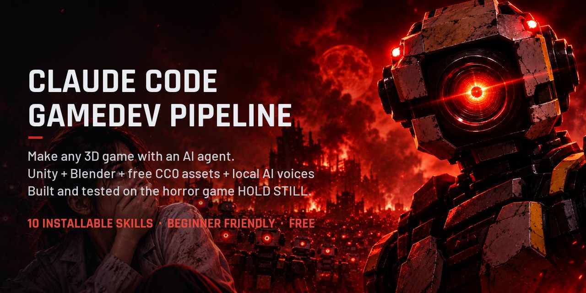
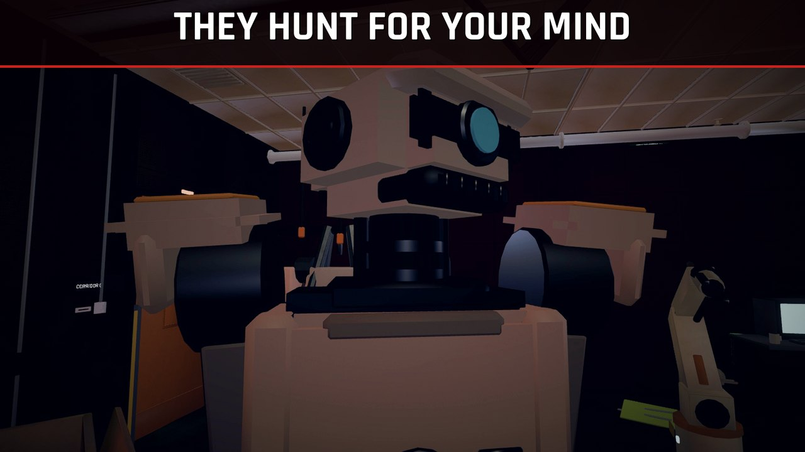
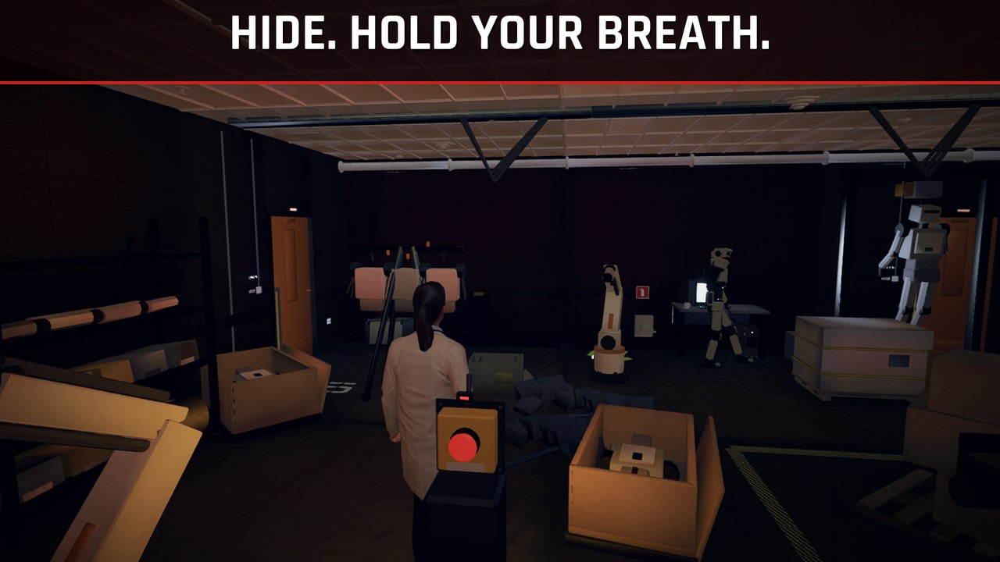
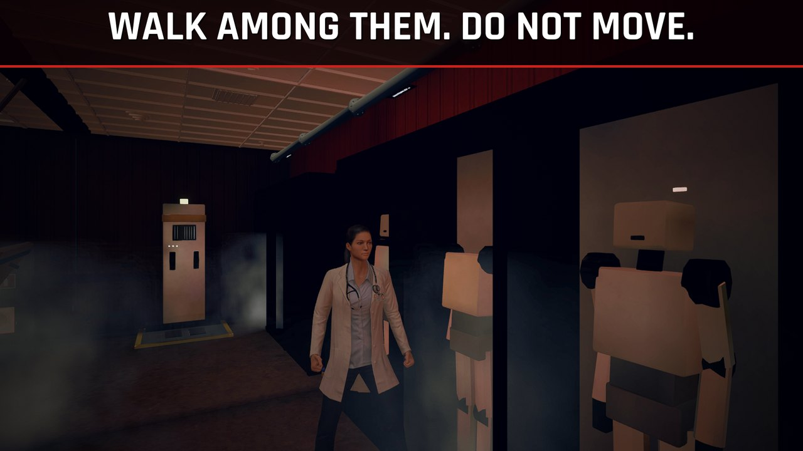
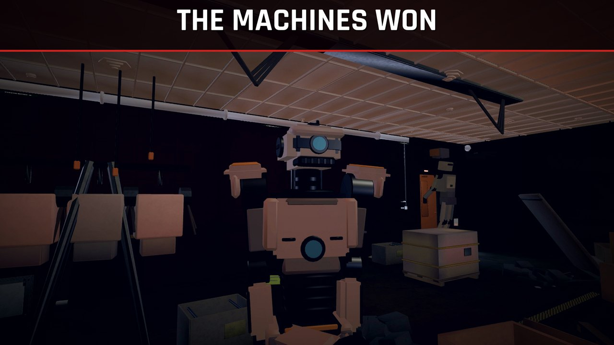
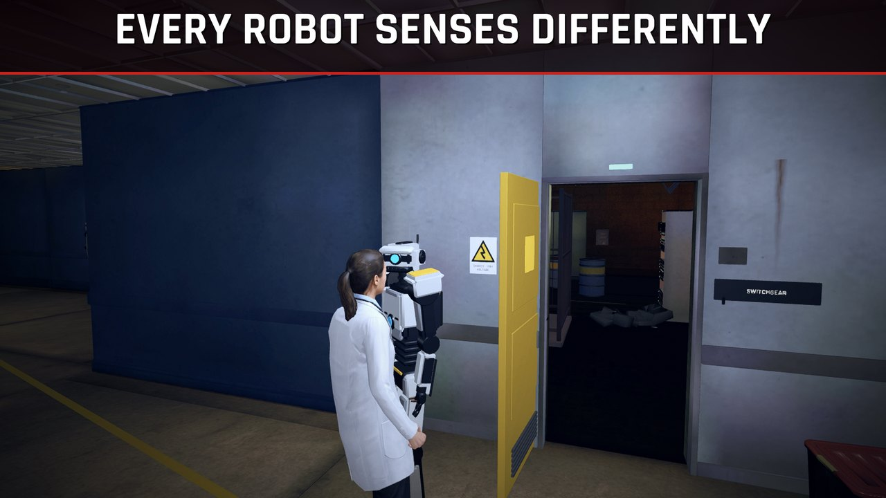
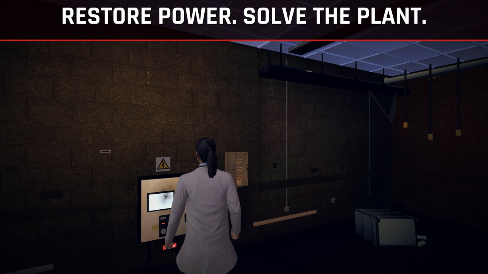
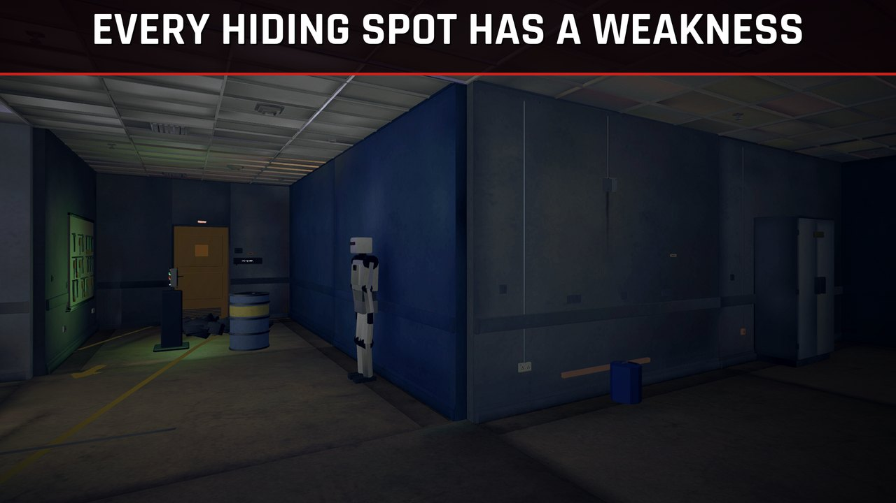
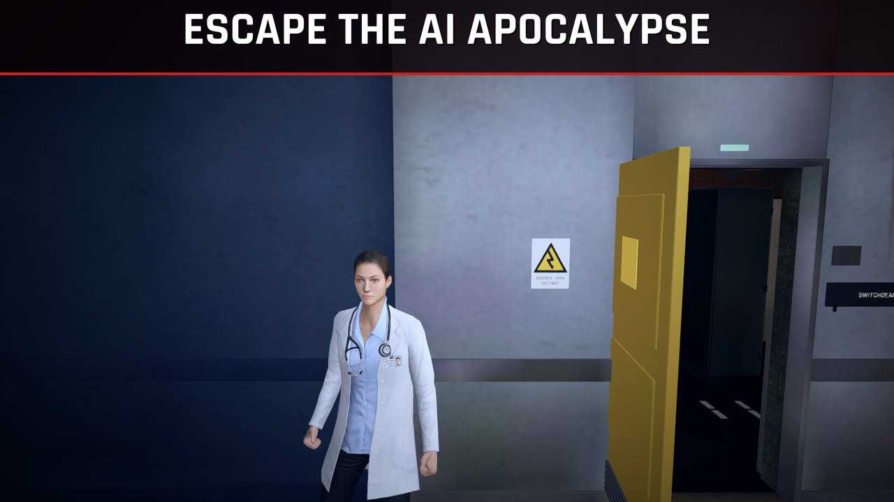
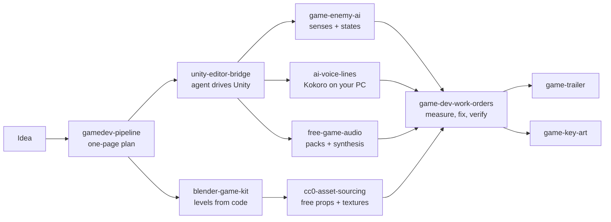

<p align="center">
  
</p>

<h1 align="center">Claude Code Gamedev Pipeline</h1>

<p align="center">
  <b>10 installable skills that teach your AI coding agent to make a real 3D game, end to end.</b><br>
  Unity + Blender + free CC0 assets + local AI voices from Hugging Face. Beginner friendly. Free.
</p>

<p align="center">
  
  
  
  
  
  
</p>

---

## Built with these skills: HOLD STILL

**HOLD STILL** is a third-person AI-apocalypse survival horror game. Robots hunt the last humans
by sight, sound and body heat; you hide, hold your breath and escape a two-floor factory. 4 acts,
17 objectives, 3 endings. Every model, sound, voice line, enemy behaviour, trailer and screenshot
in it was made with the workflow in this repo.

<p align="center">
 

https://github.com/user-attachments/assets/30e4f00f-de7a-4dab-8979-d21c04580316


  <sub><b>▶ Click to watch the 26-second trailer with sound</b> - captured at a locked 30 fps and voiced by the game's own AI characters (a scientist's tape, a child counting, the robots), with ambience that ducks under every line (skill: <code>game-trailer</code>).</sub>
</p>

<table>
  <tr>
    <td></td>
    <td></td>
  </tr>
  <tr>
    <td></td>
    <td></td>
  </tr>
  <tr>
    <td></td>
    <td></td>
  </tr>
  <tr>
    <td></td>
    <td></td>
  </tr>
</table>

<sub>Real gameplay screenshots. Every prop, texture and sound is free (CC0 / CC-BY) or generated by code; voices come from an open model running locally.</sub>

---

## What you get

The skills work for **any** game: horror, adventure, puzzle, shooter, platformer, simulation.
Each skill gives general steps first, then a real example from HOLD STILL with the numbers
that worked.

| Skill | What it teaches your agent |
|---|---|
| [`gamedev-pipeline`](skills/gamedev-pipeline/SKILL.md) | **Start here.** Turns an idea into a one-page plan and walks the whole pipeline step by step. |
| [`unity-editor-bridge`](skills/unity-editor-bridge/SKILL.md) | Drive the Unity editor: run C# inside it, wait for compiles, read errors, test in play mode with numbers. Includes a zero-dependency MCP client. |
| [`blender-game-kit`](skills/blender-game-kit/SKILL.md) | Build modular levels and props from Python in Blender (walls, doors, stairs on a grid), bake textures, cut triangles, export FBX for Unity. |
| [`cc0-asset-sourcing`](skills/cc0-asset-sourcing/SKILL.md) | Download free scanned props and PBR textures from the Poly Haven API, cut them to a game budget, repack textures for URP, keep a licence ledger. |
| [`game-enemy-ai`](skills/game-enemy-ai/SKILL.md) | Enemies that feel smart and fair: senses as channels, a suspicion meter, patrol/investigate/search/chase, hiding spots, doors, anti-camping, stuck watchdog. |
| [`ai-voice-lines`](skills/ai-voice-lines/SKILL.md) | Voice lines for free with **Kokoro-82M** from Hugging Face, running on your CPU, plus effects: radio, robot, PA, monster, ghost, cave. |
| [`free-game-audio`](skills/free-game-audio/SKILL.md) | A full soundscape for free: CC0 packs cleaned with ffmpeg (trim, loudness, seamless loops, split takes) and sounds synthesised in code. |
| [`game-dev-work-orders`](skills/game-dev-work-orders/SKILL.md) | Run the project like a studio: measured audits, numbered work orders with acceptance tests, worklog, batch fixes, build once. |
| [`game-trailer`](skills/game-trailer/SKILL.md) | Capture gameplay at a locked frame rate (no blinking), then grade, caption, title and mix sound into an MP4 from one JSON file. |
| [`game-key-art`](skills/game-key-art/SKILL.md) | Icon, key art and captioned screenshots: genre research, image-model prompts built on real frames, a caption script. |

Every script in `skills/*/scripts/` was run for real while building this repo.

## How the pipeline fits together



## Install (2 minutes)

You need [Claude Code](https://claude.com/claude-code). Pick **one** way:

**1. As a plugin (recommended).** Inside Claude Code, type:

```text
/plugin marketplace add Maimuzamilhu/claude-code-gamedev-pipeline
/plugin install gamedev-pipeline@claude-code-gamedev-pipeline
```

**2. With the open `skills` installer** (also works for other agents that read `SKILL.md`):

```bash
npx skills add Maimuzamilhu/claude-code-gamedev-pipeline
```

**3. By hand.** Download this repo (green **Code** button, then **Download ZIP**), unzip, and run:

```bash
./install.sh            # macOS / Linux / Git Bash
.\install.ps1           # Windows PowerShell
```

This copies the skills into `~/.claude/skills`. Add `--project` / `-Project` to install them
only for the game folder you are in.

## Your first prompts

Open Claude Code in an empty folder (or your Unity project) and try:

```text
I want to make a small 3D stealth game but I have never made a game. Where do I start?
Build me a modular sci-fi corridor kit in Blender and export it for Unity.
Find 5 free CC0 props for an abandoned hospital and make them game-ready.
My enemy sees me through walls and gets stuck on doors. Fix its AI.
Give my guard 6 voice lines that sound like a walkie-talkie.
Make my game's footsteps and doors sound consistent, and add an ambience loop per area.
Make a 25-second trailer from my game with captions and sound.
```

The agent loads the right skill on its own. You never need to remember names.

## What you need installed

| Tool | Why | Cost |
|---|---|---|
| [Unity 6](https://unity.com) (URP template) | the game engine | free (Personal) |
| [MCP for Unity](https://github.com/CoplayDev/unity-mcp) | lets the agent drive the editor | free, open source |
| [Blender 4.x](https://www.blender.org) + [Blender MCP](https://github.com/ahujasid/blender-mcp) | models and levels from code | free, open source |
| Python 3.10+ and [ffmpeg](https://ffmpeg.org) | audio, video and asset scripts | free |
| [Kokoro-82M](https://huggingface.co/hexgrad/Kokoro-82M) via [kokoro-onnx](https://github.com/thewh1teagle/kokoro-onnx) | AI voices on your own computer | free (Apache 2.0 / MIT) |

No paid APIs and no API keys are needed for any skill.

## FAQ

**Do I need to know how to code?** No. The skills tell the agent to explain each step in plain
words and to show you results (a screenshot, a sound, a number) after every step.

**Is it only for horror games?** No. HOLD STILL is the worked example; every skill is written for
any genre.

**Can I sell a game made with this?** Yes. The skills only point to commercial-safe sources
(CC0, MIT, Apache, OFL; CC-BY with credit) and keep a licence ledger for you. Check each asset's
licence yourself before shipping.

**Does it work with other engines?** The ideas (kits on a grid, CC0 assets, senses + suspicion
AI, locked-clock capture, work orders) work anywhere. The scripts target Unity and Blender.

**Other agents?** The skills are plain `SKILL.md` folders, so agents that support the open skill
format can read them too.

## Credits

Made by [Muzzamil Khalid](https://github.com/Maimuzamilhu). HOLD STILL uses free assets by the
Poly Haven artists (CC0), Quaternius (CC0), Microsoft Rocketbox (MIT), OpenGameArt creators
including Little Robot Sound Factory, congusbongus, JC Sounds, Axelated, dklon and MidFag
(CC-BY), Google Fonts (OFL), and the Kokoro-82M model by hexgrad (Apache 2.0).

If this helped you make something, **star the repo** and share what you built in
[Discussions](../../discussions) or an issue. PRs that add skills or improve examples are welcome.

## License

[MIT](LICENSE). The HOLD STILL trailer and screenshots in `media/` are © Muzzamil Khalid and are
included to show the results; please do not reuse them as your own game's art.
